# VaultSpace: User Guide

VaultSpace keeps sensitive documents (Aadhaar, marksheets, bank statements…) encrypted on your phone and lets you share them with limits you control.

## 1. Install
- **Android phone** (Android 9 or newer):
  1. Download `VaultSpace.apk` from: **&lt;APK link&gt;**
  2. Open it and allow "Install unknown apps" for your browser or file manager when asked.
- **No Android phone?** Use the Android Studio emulator (any Android 9+ image), or the course's cloud simulator, and drag the APK onto it.
- **Network:** the app talks only to the VaultSpace server on the IIIT-Delhi network (`192.168.2.242`). Your phone must be on the campus network (e.g. campus Wi-Fi); there is nothing else to set up.

## 2. Create an account
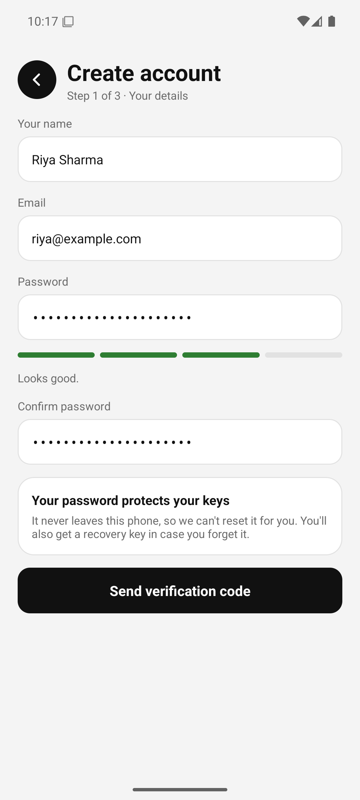

1. Tap **Create an account**.
2. Enter your name, email and a password of at least 12 characters. The bar shows its strength. Three or four random words work well.
3. Enter the **6-digit code** we email you.
4. **Save your recovery key.** It's the only way back into your files if you forget your password: we can't reset it, because we never see your password. Write it down, tick the box, and type its last 4 characters.

## 3. Your vault
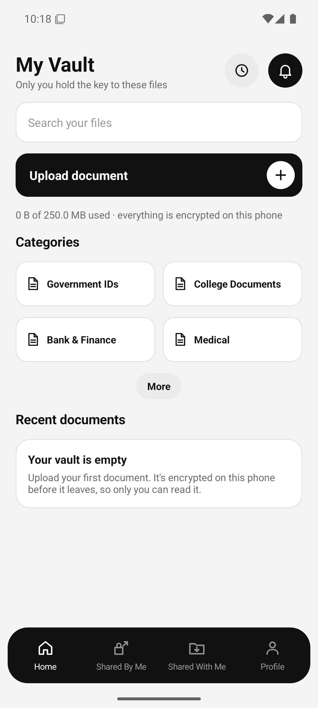 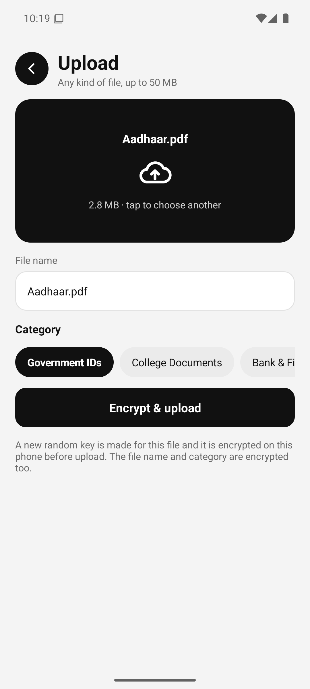

- **Upload document**:
  1. Choose any file up to 50 MB.
  2. Pick a category.
  3. Tap **Encrypt & upload**. The file and its name are encrypted on your phone first.
- **Search and categories** filter your files.
- **Tags:** "Only you" means not shared; "Shared · 2" means two people currently have access.
- **The ⋯ menu** on a file: Open, Share, Who has access, Rename, Delete.

## 4. Share a file
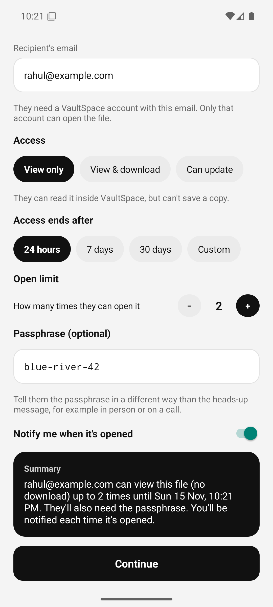 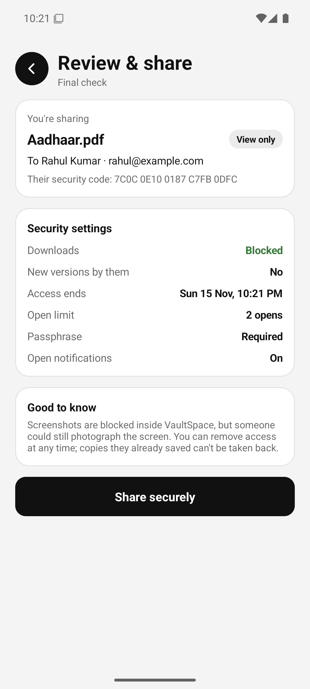

1. Open a file and tap **Share file**.
2. Enter the recipient's email. They need a VaultSpace account with that email.
3. Choose:
    - **Access:**
        - **View only** (default): they can read it in VaultSpace but can't save it.
        - **View & download.**
        - **Can update:** they can also upload a new version.
    - **Access ends after** 24 hours, 7 days, 30 days, or a custom number of hours.
    - **Open limit:** how many times they can open it.
    - **Passphrase (optional):** tell it to them in person or on a call, not in the same chat.
    - **Notify me when it's opened.**
4. Read the **summary sentence**, tap **Continue**, check the review, then tap **Share securely**.
5. Optionally tap **Send a heads-up**. The message contains no secret; only their account can open the file.

## 5. Manage access
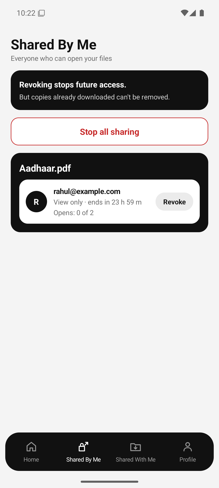 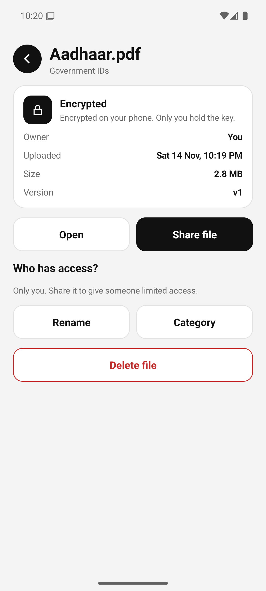

- **Shared By Me** lists everyone who can open your files, with time left and opens used.
  - **Revoke** removes one person's access immediately.
  - **Stop all sharing** removes everyone.
  - Copies someone already downloaded can't be removed.
- **File details** shows who has access, past shares, and versions. You can open or restore older versions.

## 6. Files shared with you
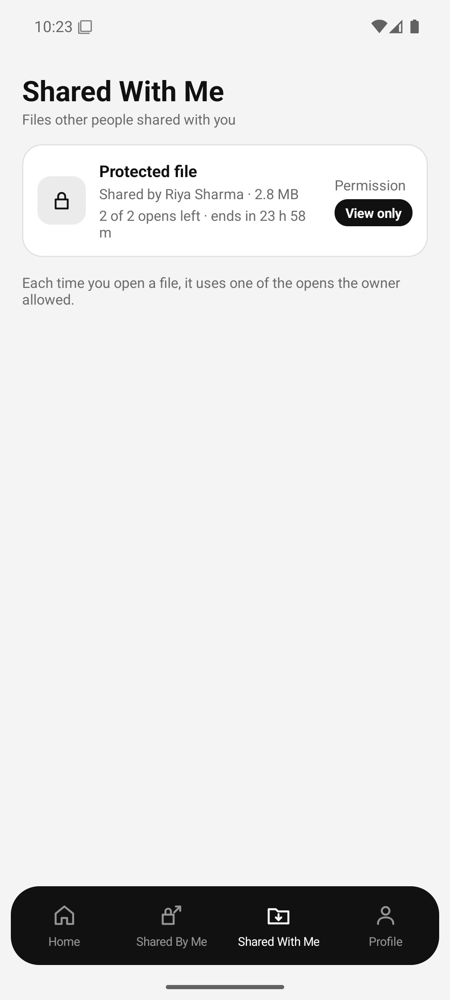 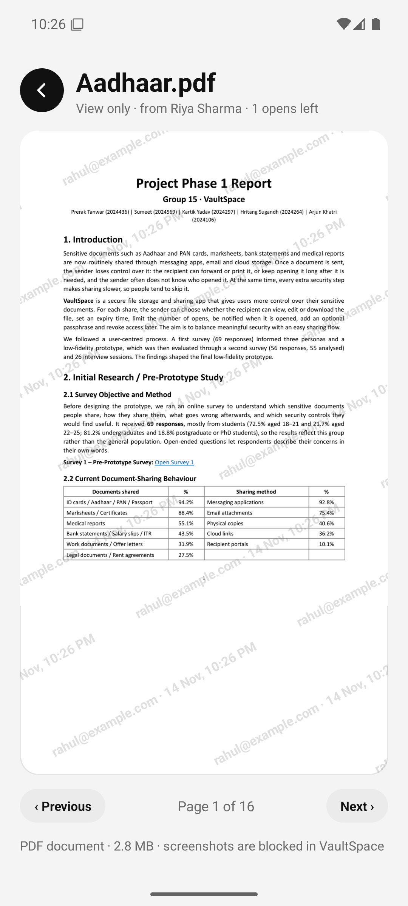

- **Shared With Me** shows each file, who sent it, your permission, and the opens and time you have left.
- Each open uses one of the opens the owner allowed. You're warned before your last one.
- **Passphrase:** a protected file shows as "Protected file" until you enter it. After 5 wrong tries it locks.
- **Viewing:** your email and the time are shown as a watermark. Screenshots are blocked.

## 7. Activity and alerts
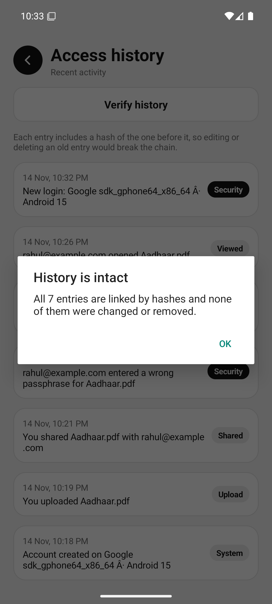

- **The bell** shows openings, downloads, new versions and security alerts (new logins, wrong passphrases).
- **The clock icon** (Access history) lists everything that happened. **Verify history** checks that nobody altered it.

## 8. Profile and security settings
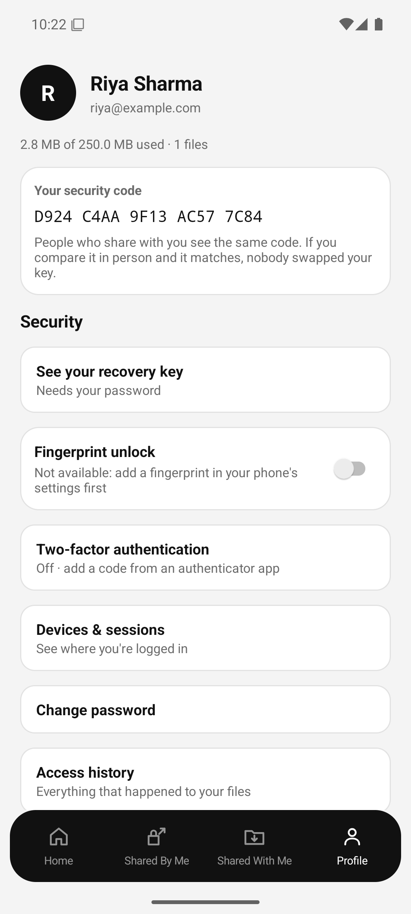 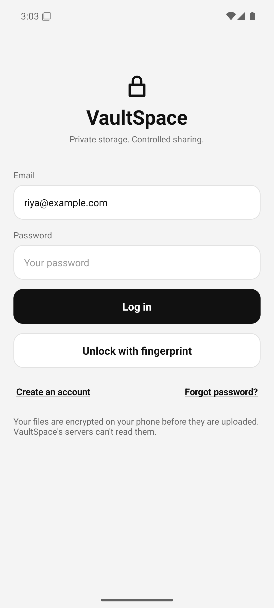

- **See your recovery key**: needs your password.
- **Fingerprint unlock**: unlock this phone with your fingerprint. It's turned off automatically if fingerprints change.
- **Two-factor authentication**: add a 6-digit code from Google or Microsoft Authenticator.
- **Devices & sessions**: see where you're logged in, remove phones, or log out everywhere else.
- **Change password**: your files stay as they are; other devices are logged out.
- **Delete account**: removes all your files and shares for good.

## 9. Good to know
- **Auto-lock:** VaultSpace locks after 5 minutes without activity, or 1 minute in the background.
- **Forgot your password?** Use **Forgot password?**. You need the email code *and* your recovery key.
- **What can't be prevented:**
  - someone photographing the screen with another device (the watermark shows who it was)
  - copies saved when you allowed downloads
  - someone using your phone while it's unlocked
- **What the server can see:** sizes and timing of files, but never names or contents.

## 10. Reporting a problem
Contact Group 15. Please include:
- the steps to reproduce
- what you expected to happen
- screenshots from outside the app, since screenshots inside VaultSpace are blocked by design
